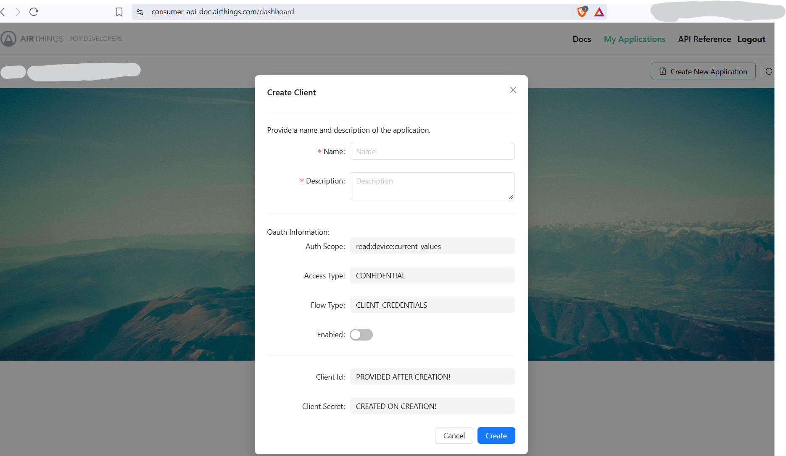

# Journal

Background: The idea here is human notes about what was done during the project that

## 11/14/2026

1. Manually set up AWS Account
2. Upon completion, I was given a prompt to give to the agent.
```
Set up Agent Toolkit for AWS by following instructions:
https://raw.githubusercontent.com/aws/agent-toolkit-for-aws/refs/heads/main/setup-instructions/setup.md

Your AWS Region is: us-east-2
AWS experience: The new AWS experience
```
3. Manually set up project, `Portfolio-2026-November`
4. Manually set up an AWS budget for $100/month
5. Via Prompt
```
What I did:

AWS CLI 2.40.3: installed. The serpentair profile signs in through aws login in us-east-2 and is verified. It runs as AccountFullAccessRole in account 900417081299.
uv: installed, because the MCP server needs it.
Agent Toolkit:
MCP entries: aws-mcp was added to ~/.claude.json and Cursor's mcp.json, both pointed at the serpentair profile. I backed up both files first (*.bak-awsmcp).
AWS skills: it also installed 25 AWS skills into your global ~/.claude/skills, so they'll show up in every project, not just this one.
AGENTS.md:
New "AWS access" section: names the profile and says the MCP and CLI are for reading state and docs only. All changes go through Terraform, and later CI. Since the role has full access, that rule is the only guard.
AWS starter rules: added below that, between the toolkit's markers. Your section comes first, and those rules say project instructions take precedence over them.
This isn't committed yet.
```
6. Restarted VS Code to pick up new `aws` CLI path.
7. Tested AWS CLI installation with `aws --version`
response:
```
aws-cli/2.40.3 Python/3.14.8 Windows/11 script-exe/AMD64
```
8. Tested AWS CLI Profile configuration with 
``
$ `aws sts get-caller-identity --profile serpentair`
response:
```
{                                                                     
    "UserId": "ARO...",
    "Account": "900...",
    "Arn": "arn:aws:sts::900...:assumed-role/AccountFullAccessRole/141..."
}
```
9. Re-oriented around next steps:
- Me: You sign up for 
- Airthings (API client), 
- Prefect Cloud
- dbt platform.
 I write a /wizard script that opens each page and saves the credentials into a git-ignored .env.
- Agent: (other things)
10. Airthings - Account and API Access
    - Go to the Airthings dashboard (consumer-api-doc.airthings.com/dashboard) and sign in with your normal Airthings account. It sends you to accounts.airthings.com.
    - Open My Applications and click Create New Application.
    
    - Give it a name (for example serpentair) and a short description. If you're asked for a flow type, pick the client credentials (machine-to-machine) option. The Lambda signs in as itself, not as you in a browser.
    - Copy the Client ID and Client Secret somewhere safe right away, such as a password manager. Don't put them in the repo or the journal. Later they'll go into .env, then AWS Secrets Manager.
11. Used Matt Pocock /wizard skill to capture ClientID and ClientSecret. 
- The Wizard skill generates a .sh file
- You run the .sh file
- It then walks you through visiting the right webpage, copy/pasting values, and then runs a test API call to validate you can authenticate - very nice
